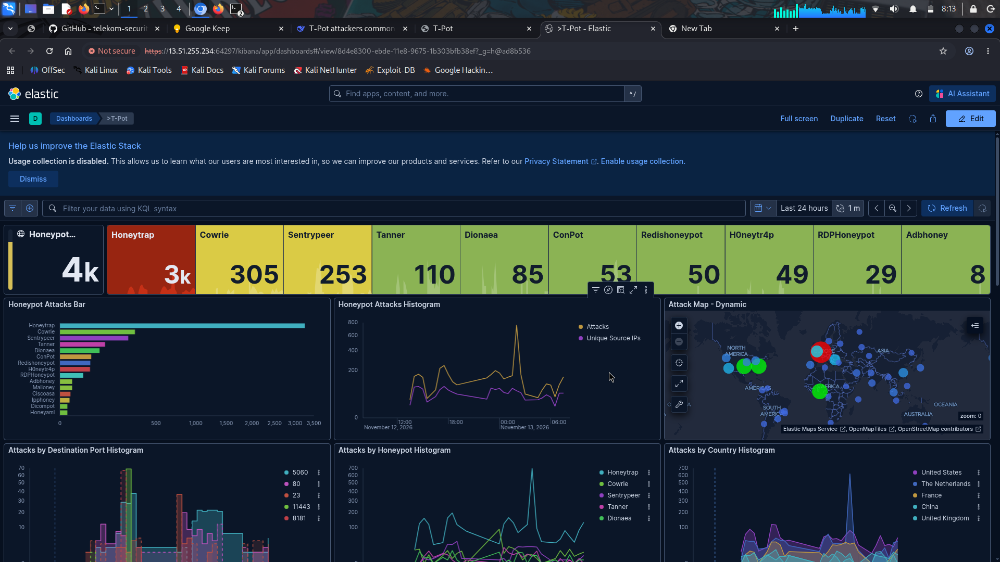
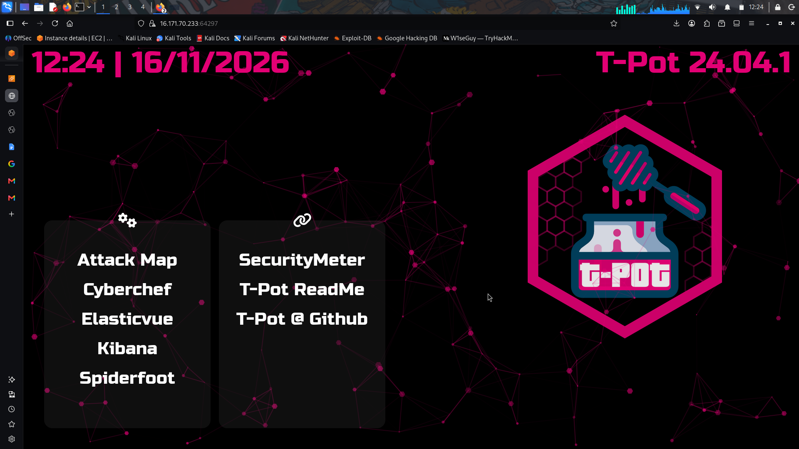
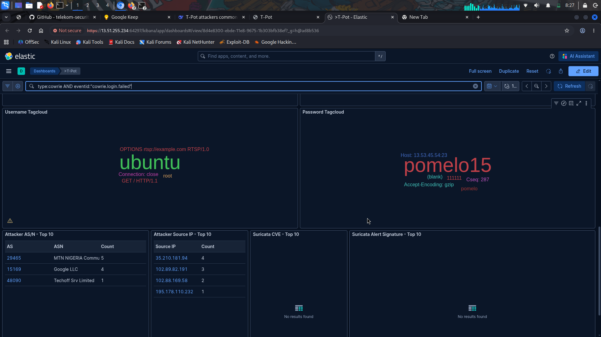
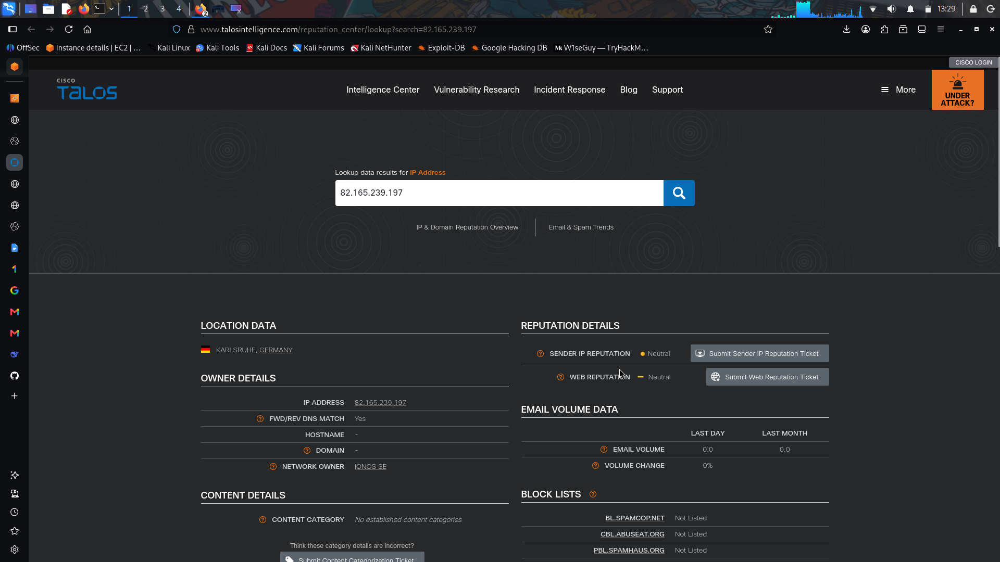
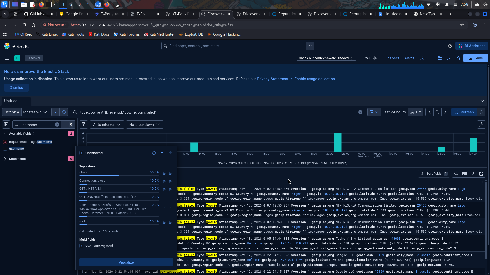
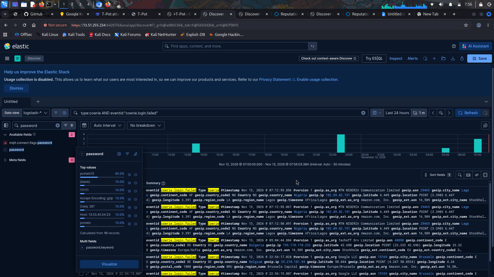
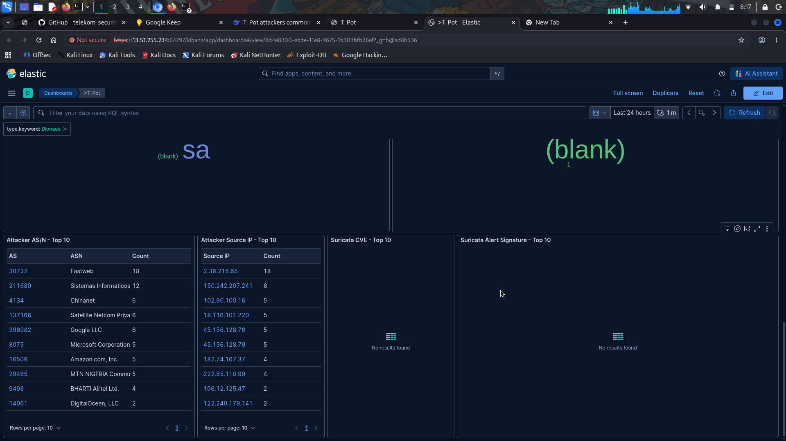

# T-Pot Honeypot Threat Analysis Report

**Analyst:** Princess  
**Environment:** T-Pot Honeypot Deployment  
**Data Source:** Elastic Stack (Kibana), Cowrie, Dionaea, Honeytrap  
**Date of Observation:** November 13, 2026

---

## 1. Executive Summary

During the observation window, the T-Pot deployment captured approximately **4,000 attack events**. Analysis of the telemetry confirms that public-facing infrastructure is subjected to constant, automated exploitation attempts. 

While the highest volume of traffic (3,000+ events) consisted of non-interactive port-scanning noise captured by **Honeytrap**, the primary active threat vector was **SSH Brute-Forcing** targeting the **Cowrie** honeypot (305 events). Secondary attacks included SMB and database exploitation targeting the **Dionaea** honeypot. The attackers utilized distributed botnets leveraging commercial cloud infrastructure and compromised residential ISPs. Threat intelligence lookups on the top source IP (`35.210.181.94`) confirmed it is associated with a malicious cloud server. No malware payloads were successfully dropped during the observation period.

*Figure 1: T-Pot global dashboard displaying overall attack volume, honeypot distribution, and global attack map.*

---

## 2. Introduction & Methodology

### 2.1 The Essence of a Honeypot
A honeypot is a deception technology. It is a deliberately vulnerable, fake system designed to attract attackers away from real assets. Because it has no production value and no legitimate users, *any* interaction with a honeypot is inherently malicious. 

T-Pot aggregates multiple honeypot containers simultaneously to provide a comprehensive view of the global threat landscape. It allows security analysts to study attacker behavior without putting real servers at risk.

*Figure 2: The T-Pot Landing Page dashboard, providing access to Kibana, Attack Map, and SecurityMeter telemetry.*

### 2.2 Methodology & Kibana Queries 
To separate high-severity threats from background noise, we utilized KQL (Kibana Query Language) to filter the telemetry:
*   **`type:cowrie AND eventid:"cowrie.login.failed"`** – Isolated SSH authentication failures to analyze brute-force dictionary attacks.
*   **`type.keyword: Dionaea`** – Isolated SMB and database exploitation attempts to identify legacy vulnerability scanning.

---

## 3. Question 1: Who are the attackers?

**The Threat Actor Profile:** Automated Botnets and Scanning Infrastructure.

The evidence strongly indicates that the attackers are not human operators, but rather automated scripts (bots). This is proven by the attack timeline: multiple authentication attempts occur within the exact same second. A human cannot type that fast, confirming the use of automated dictionary scripts. 

*Figure 3: Kibana dashboard showing the rapid-fire timeline of attacks and the top attacking networks.*

**Infrastructure Analysis (GeoIP & ASN):**
The attackers are leveraging a mix of commercial and compromised infrastructure:
1.  **Cloud Providers (Rented Infrastructure):** A significant portion of the attacks originated from **Google Cloud** (IP: `35.210.181.94`) and **Amazon AWS** (Stockholm/Brussels). Attackers routinely rent cheap Virtual Private Servers (VPS) to execute brute-force scripts, allowing them to rotate IPs and evade blocklists.
2.  **Compromised ISPs (Botnet Nodes):** We observed high volumes of traffic from **MTN Nigeria** (IP: `102.89.82.191`) and **Fastweb** (Italy). This indicates that attackers are utilizing compromised home routers or unpatched IoT devices to mask their origin. 

*Figure 4: Cisco Talos Threat Intelligence lookup for IP 35.210.181.94, confirming its reputation as a malicious source originating from Google Cloud infrastructure.*

---

## 4. Question 2: What is the most common attack?

**Primary Threat:** SSH Brute-Forcing (Credential Stuffing).

The most common active attack is SSH Brute-Forcing. Attackers are attempting to gain unauthorized access to the server's command line by guessing administrative credentials. 

**Deep Dive into the Attack:**
*   **Targeted Accounts:** The bots heavily prioritized the **`ubuntu`** username (roughly 50% of attempts), followed by **`root`**. This proves the attackers know cloud servers often ship with these default accounts.
*   **The Password Dictionary:** The top attempted password was **`pomelo15`** (often paired with the username `pomelo`), followed by weak defaults like **`111111`** and blank passwords. 

*Figure 5: Kibana Discover tab filtering for `cowrie.login.failed`. The pop-up reveals the top targeted usernames (`ubuntu` and `root`).*

*Figure 6: Kibana Discover tab showing the top attempted passwords. The word cloud reveals `pomelo15` as the most common password.*

*   **Malformed Bot Traffic:** Interestingly, we observed HTTP headers (like `GET /HTTP/1.1`) being input as usernames. This indicates poorly configured bots attempting to send web requests to the SSH port, highlighting the low sophistication of the scripts.

*(Note on Honeytrap: While Honeytrap recorded 3,000+ events, this is background noise—bots sweeping IP ranges for open ports. SSH is the most common actual attack).*

---

## 5. Secondary Threat: SMB & Database Exploitation (Dionaea)

Filtering for the Dionaea honeypot revealed automated exploitation attempts against Windows file-sharing and SQL databases.

*Figure 7: Kibana dashboard filtered for `type.keyword: Dionaea`, showing automated attacks targeting the Microsoft SQL `sa` account.*

*   **The Attack Vector:** The primary pattern was attempted authentication using the default Microsoft SQL Server administrator account (**`sa`**) with a **blank password**. This is a classic "low-hanging fruit" attack, hoping to find an unsecured, misconfigured database.
*   **The Source:** These attacks originated from **Fastweb** (Italy), **Chinanet** (China), and various cloud providers.
*   **Malware Analysis:** A search for `eventid:"dionaea.capture"` returned zero results. This means while attackers probed the service, no actual viruses or payloads were successfully uploaded during this window.

---

## 6. Threat Assessment & Strategic Recommendations

### 6.1 Assessment
This dataset demonstrates the "background radiation" of the internet. Any server exposed to the public web will be subjected to these attacks within minutes of coming online. The absence of Suricata network IDS alerts for these events confirms the attackers are not using advanced software exploits, but rather relying on human laziness (weak/default passwords).

### 6.2 Defensive Recommendations for Production Systems
To defend against the observed attacks, the following security controls should be implemented:
1.  **Enforce SSH Key Authentication:** Disable password-based logins entirely. Cryptographic keys cannot be brute-forced.
2.  **Identity Hardening:** Disable direct `root` login and rename or disable default accounts like `ubuntu`.
3.  **Deploy Rate Limiting (Fail2Ban):** Automatically block source IPs after 3-5 failed login attempts.
4.  **Database Security:** Ensure the `sa` account is disabled or protected by a complex password, and enforce network-level isolation for database ports (port 1433/3306).

### 6.3 Conclusion
The T-Pot honeypot successfully demonstrated the reality of modern cyber threats: the internet is constantly scanned by automated bots looking for low-effort targets. The data proves that human error (using default usernames like `ubuntu` and weak passwords like `111111`) is the primary vulnerability attackers exploit. By isolating these threats in a controlled environment, we can confidently implement defenses like SSH key authentication and database hardening to protect real production assets from these relentless automated campaigns.
